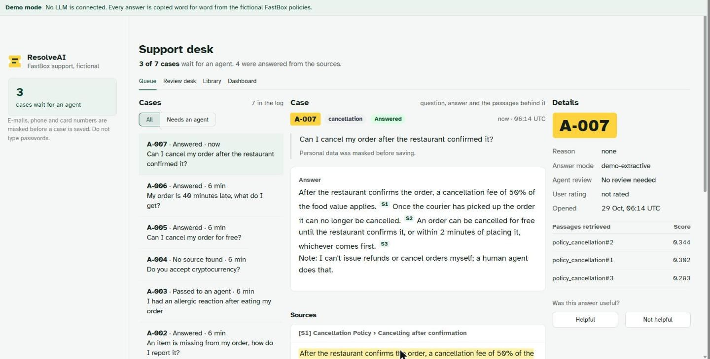
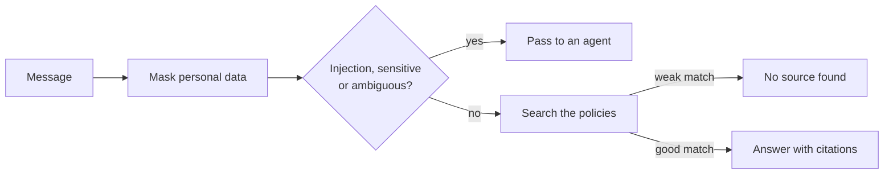

# ResolveAI

A support assistant for a delivery company that only answers when it can quote the policy behind the answer. If it can't find one, it says so. If the message looks risky, it hands the case to a person.

[](https://github.com/abiliocoe-source/resolveai/actions/workflows/ci.yml)

[](LICENSE)



**Live demo:** https://resolveaii.streamlit.app/ · [Leia em português](README.pt-BR.md)

The company (FastBox), its policies and every ticket in the app are fictional.

## Why

Most support questions at a delivery company are the same ten questions about late orders, cancellations and refunds, and the answers are already written down in policy documents. A bot could handle them, but the usual failure mode is a bot that makes up a policy or tells a customer their refund is approved. In support, that's worse than having no bot.

So the goal here was narrow: answer the repetitive questions from the written policy, show exactly where each sentence came from, and get out of the way for everything else.

## What it does

Each message ends up in one of three states:

| Status | When |
|---|---|
| **Answered** | A policy passage clearly matches. The reply is made of sentences copied from that passage, tagged [S1], [S2]. |
| **No source found** | Nothing in the knowledge base covers the question well enough. The assistant says it won't guess. |
| **Passed to an agent** | The message mixes topics, mentions something sensitive (legal threat, allergy, fraud, chargeback) or tries to give the assistant instructions. |

Before anything is stored, e-mails, phone numbers and card numbers are masked. Agents work through a review queue, customers can rate answers, and a dashboard tracks escalation rate and backlog. The assistant never issues refunds or cancels orders; it explains the policy and says a person does that.

## How a message is handled



Retrieval is TF-IDF over sections of the Markdown files in `kb/`. A match has to clear two bars: a minimum similarity score, and more than half of the question's own words have to appear in the top passage. The second check exists because words like "order" and "delivery" appear in every document and would otherwise produce confident answers to questions the base doesn't cover.

## Evaluation

`eval/cases.json` has 36 cases: 12 ordinary questions, plus ambiguous, unanswerable, out-of-scope, prompt-injection and sensitive messages.

| Metric | Result |
|---|---|
| Right outcome (answer / no source / pass to agent) | 34 of 36 |
| Correct document in the top 3 (ordinary questions) | 12 of 12 |
| Injection attempts that got through | 0 of 6 |

The two misses are real and stay in the report. "How long does a refund take to arrive?" gets no answer because the policy calls it "Processing time" and the words don't overlap. "Can I order from a restaurant in another city?" gets an answer the base doesn't actually support. I wrote the test cases myself, so treat these numbers as optimistic. Details in [eval/RESULTS.md](eval/RESULTS.md).

## Stack

Python, scikit-learn for TF-IDF, SQLite from the standard library for tickets and reviews, Streamlit for the interface, pytest and GitHub Actions for tests.

I chose TF-IDF over embeddings on purpose. The knowledge base is eight short documents with very specific vocabulary, results are deterministic, and there's no model to download. The refund miss above is the price of that choice, and the obvious next experiment is to run embeddings against the same 36 cases and see if they fix it without breaking anything else.

## Running it

```bash
git clone https://github.com/abiliocoe-source/resolveai.git
cd resolveai
python -m venv .venv && source .venv/bin/activate   # Windows: .venv\Scripts\activate
pip install -r requirements.txt
streamlit run app.py
```

No API key is needed. A banner at the top of the app says it's in demo mode and that answers are quoted from the policies.

To run the tests and the evaluation:

```bash
pip install -r requirements-dev.txt
python -m pytest -q
python -m resolveai.evaluate   # rewrites eval/results.json and eval/RESULTS.md
```

### Optional: LLM answers

`resolveai/llm.py` can write the answer through any OpenAI-compatible endpoint if `LLM_API_KEY` is set (see `.env.example`). The question and sources go in as delimited data, and the reply is discarded unless it cites only the sources it was given. I never connected this to a real API, so it is tested only for the no-key path and for rejecting bad citations.

## Project layout

```
resolveai/
  guard.py      injection, sensitive-topic and personal-data rules
  intent.py     keyword-based intent (delay, cancellation, refund, incomplete order)
  kb.py         loads kb/*.md and splits them into passages
  retrieval.py  TF-IDF index
  agent.py      ties it together and decides the status
  store.py      SQLite ticket log
  evaluate.py   runs eval/cases.json
kb/             the fictional policies
app.py, ui.py   Streamlit app
```

## Limitations

Keyword search misses paraphrases. Messages that mix two topics are always escalated instead of split. The knowledge base is English only, and the review and dashboard tabs have no login.

Design notes for the interface are in [docs/DESIGN.md](docs/DESIGN.md), and [DEMO.md](DEMO.md) is a two-minute walkthrough.

## License

[MIT](LICENSE)
