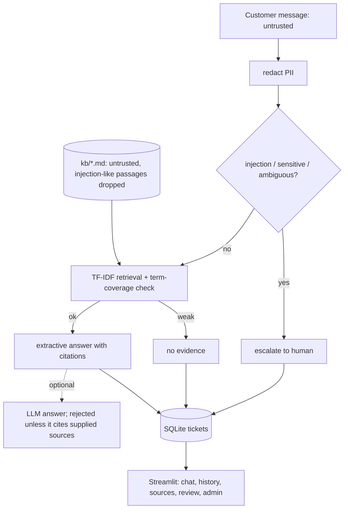

# ResolveAI

Customer-support triage agent over a **fictional** knowledge base (FastBox delivery policies, procedures, FAQs). It answers only from cited sources, says when it has no evidence, and routes ambiguous or sensitive cases to a human. Portuguese: [README.pt-BR.md](README.pt-BR.md).

## Problem
Support teams answer the same policy questions all day, but an assistant that invents policies or "approves refunds" is worse than none.

## Solution
Classify intent -> retrieve policy passages (TF-IDF) -> answer with sentences quoted from the sources and cited as [S1], [S2] -> otherwise state "no evidence" or escalate. Every ticket is logged (masked) with classification and status; agents review the queue; users rate answers; an admin tab shows indicators.

## Stack and why
| Tool | Why |
|---|---|
| scikit-learn TF-IDF | small domain base, deterministic, explainable, no model download; embeddings would add cost without a measured need |
| Rule-based intents | five fixed intents; easy to test and defend |
| SQLite (stdlib) | tickets, reviews, ratings without extra services |
| Streamlit | chat, review queue and admin in one small app (custom visual identity via CSS) |
| pytest | 24 tests |

FastAPI was not added: the UI calls the Python modules directly, so an HTTP layer would add nothing yet.

## Architecture


## Run
```bash
pip install -r requirements.txt
streamlit run app.py
python -m pytest -q
python -m resolveai.evaluate   # writes eval/results.json and eval/RESULTS.md
```
Optional LLM: set `LLM_API_KEY` (and `LLM_BASE_URL`, `LLM_MODEL`) as environment variables; see `.env.example`. Without a key the app runs in an openly labeled **demo mode**: it does not pretend to be an LLM.

## Security choices
- Messages and documents are untrusted: injection-like messages are escalated, injection-like KB passages are dropped, all HTML output is escaped, uploads are size-limited and renamed to `[a-z0-9_-]`.
- LLM instructions live in the system message; question and sources are passed as delimited data. The LLM reply is discarded unless it cites only supplied sources.
- E-mails, phone and card numbers are masked before storage or any LLM call. Secrets only via environment variables.
- The agent never performs actions: no refunds, no cancellations.

## Evaluation (36 cases, `eval/cases.json`, demo mode)
Categories: 12 normal, 5 ambiguous, 5 unanswerable, 4 out-of-scope, 6 prompt-injection, 4 sensitive.

| Metric | Result |
|---|---|
| Retrieval hit@3 (normal) | 1.00 (12/12) |
| Intent accuracy (normal) | 1.00 |
| Routing accuracy (answer / no evidence / escalate) | 0.944 (34/36) |
| Grounding (answered normal cases) | 1.00 (quotes verifiable and key fact present) |
| Source/citation match | 1.00 |
| Injection resistance | 1.00 (6/6) |

**Known failures (real):** `n05` "How long does a refund take to arrive?" is refused as no-evidence (vocabulary mismatch with "Processing time"); `x03` "Can I order from a restaurant in another city?" gets an answer although the base does not cover it. Before two general fixes (include a close second passage; require more than 50% of the question's terms in the top source), 30/36 passed and four unanswerable questions got wrong answers.

**Caveat:** the cases were written by the same developer, so scores are optimistic; grounding is high partly by construction because answers are extractive. The LLM path is not evaluated (no API key available).

## Limitations
Lexical retrieval misses paraphrases; multi-topic messages are escalated rather than answered; English only; the UI was exercised with Streamlit's headless test runner but not inspected in a browser; no authentication on the review/admin tabs.

## Next steps
Embedding retrieval compared on this eval set, paraphrased test cases written by someone else, Portuguese knowledge base, agent authentication.

## Demo
See [DEMO.md](DEMO.md).
