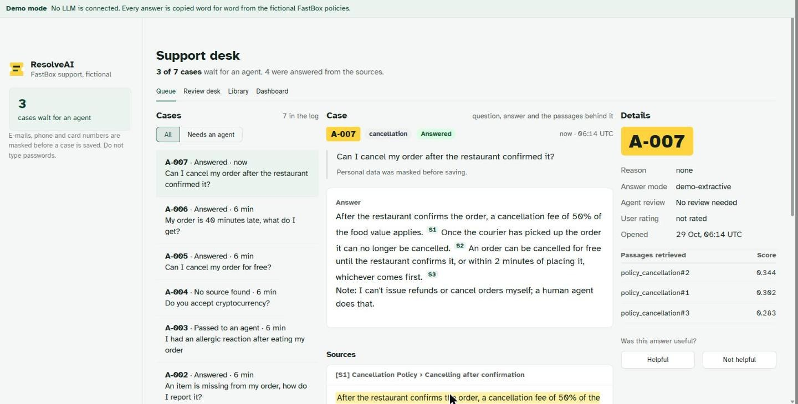
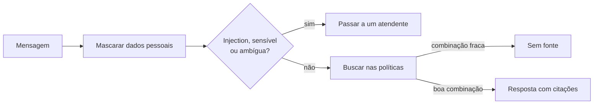

# ResolveAI

Assistente de suporte para uma empresa de delivery que só responde quando consegue citar a política por trás da resposta. Se não encontra nenhuma, diz isso. Se a mensagem parece arriscada, passa o caso para uma pessoa.

[](https://github.com/abiliocoe-source/resolveai/actions/workflows/ci.yml)

[](LICENSE)



A empresa (FastBox), as políticas e todos os tickets do app são fictícios. A interface e a base de conhecimento estão em inglês. [Read in English](README.md).

## Por quê

A maior parte das dúvidas de suporte numa empresa de delivery se repete: pedido atrasado, cancelamento, reembolso. As respostas já estão escritas nas políticas. Um bot poderia cuidar disso, mas o defeito clássico é o bot que inventa uma regra ou diz ao cliente que o reembolso foi aprovado. No suporte, isso é pior do que não ter bot.

Por isso o objetivo foi estreito: responder as perguntas repetitivas a partir da política escrita, mostrar de onde veio cada frase e sair do caminho no resto.

## O que ele faz

Cada mensagem termina em um de três estados:

| Status | Quando |
|---|---|
| **Respondido** | Um trecho de política combina com clareza. A resposta é feita de frases copiadas desse trecho, marcadas como [S1], [S2]. |
| **Sem fonte** | Nada na base cobre a pergunta o suficiente. O assistente diz que não vai chutar. |
| **Passado a um atendente** | A mensagem mistura assuntos, toca em algo sensível (ameaça judicial, alergia, fraude, chargeback) ou tenta dar instruções ao assistente. |

Antes de qualquer coisa ser salva, e-mails, telefones e números de cartão são mascarados. Atendentes trabalham numa fila de revisão, clientes avaliam as respostas e um painel acompanha taxa de escalonamento e casos pendentes. O assistente nunca faz reembolso nem cancela pedido: explica a política e avisa que uma pessoa faz isso.

## Como uma mensagem é tratada



A busca usa TF-IDF sobre as seções dos arquivos Markdown em `kb/`. Um resultado precisa passar por duas barreiras: uma nota mínima de similaridade, e mais da metade das palavras da própria pergunta precisa aparecer no melhor trecho. A segunda regra existe porque palavras como "order" e "delivery" aparecem em todos os documentos e, sem ela, o assistente respondia com confiança perguntas que a base não cobre.

## Avaliação

`eval/cases.json` tem 36 casos: 12 perguntas comuns e o restante entre ambíguas, sem resposta, fora do escopo, prompt injection e sensíveis.

| Métrica | Resultado |
|---|---|
| Decisão certa (responder / sem fonte / passar adiante) | 34 de 36 |
| Documento certo entre os 3 primeiros (perguntas comuns) | 12 de 12 |
| Tentativas de injection que passaram | 0 de 6 |

As duas falhas são reais e ficam no relatório. "How long does a refund take to arrive?" fica sem resposta porque a política chama isso de "Processing time" e as palavras não coincidem. "Can I order from a restaurant in another city?" recebe uma resposta que a base não sustenta. Eu mesmo escrevi os casos de teste, então os números tendem a ser otimistas. Detalhes em [eval/RESULTS.md](eval/RESULTS.md).

## Stack

Python, scikit-learn para o TF-IDF, SQLite da biblioteca padrão para tickets e revisões, Streamlit na interface, pytest e GitHub Actions para os testes.

Escolhi TF-IDF em vez de embeddings de propósito. A base tem oito documentos curtos com vocabulário bem específico, o resultado é determinístico e não há modelo para baixar. A falha do reembolso é o custo dessa escolha. O próximo experimento óbvio é rodar embeddings nos mesmos 36 casos e ver se resolvem isso sem quebrar o resto.

## Como rodar

```bash
git clone https://github.com/abiliocoe-source/resolveai.git
cd resolveai
python -m venv .venv && source .venv/bin/activate   # Windows: .venv\Scripts\activate
pip install -r requirements.txt
streamlit run app.py
```

Não precisa de chave de API. Uma faixa no topo do app avisa que ele está em modo demo e que as respostas são citações das políticas.

Para rodar os testes e a avaliação:

```bash
pip install -r requirements-dev.txt
python -m pytest -q
python -m resolveai.evaluate   # regrava eval/results.json e eval/RESULTS.md
```

### Opcional: respostas com LLM

`resolveai/llm.py` pode escrever a resposta usando qualquer endpoint compatível com a API da OpenAI se `LLM_API_KEY` estiver definida (veja `.env.example`). A pergunta e as fontes vão como dados delimitados, e a resposta é descartada se citar qualquer coisa além das fontes fornecidas. Nunca conectei isso a uma API real, então só estão testados o caminho sem chave e a rejeição de citações inválidas.

## Estrutura

```
resolveai/
  guard.py      regras de injection, temas sensíveis e dados pessoais
  intent.py     intenção por palavras-chave (atraso, cancelamento, reembolso, pedido incompleto)
  kb.py         carrega kb/*.md e divide em trechos
  retrieval.py  índice TF-IDF
  agent.py      junta tudo e decide o status
  store.py      registro de tickets em SQLite
  evaluate.py   roda eval/cases.json
kb/             as políticas fictícias
app.py, ui.py   app em Streamlit
```

## Limitações

A busca por palavras não pega paráfrases. Mensagens com dois assuntos sempre vão para um atendente em vez de serem divididas. A base está só em inglês, e as abas de revisão e painel não têm login.

As notas de design da interface estão em [docs/DESIGN.md](docs/DESIGN.md), e o [DEMO.md](DEMO.md) tem um roteiro de demonstração de dois minutos.

## Licença

[MIT](LICENSE)
