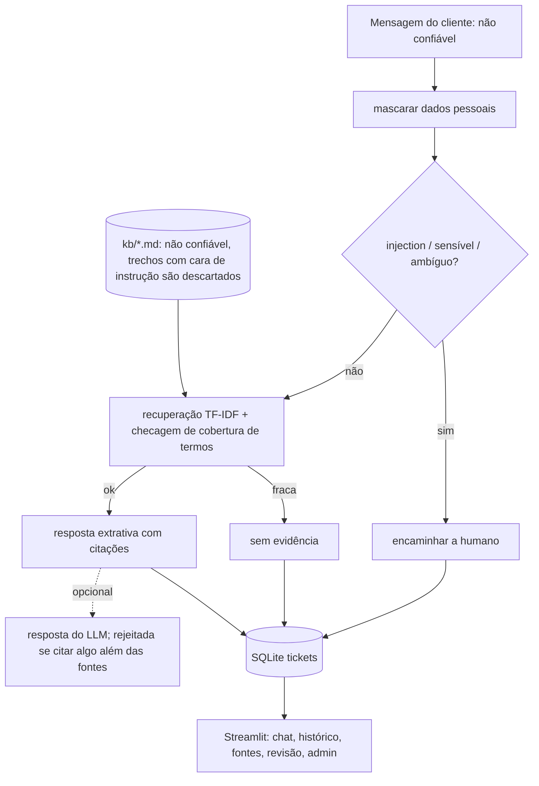
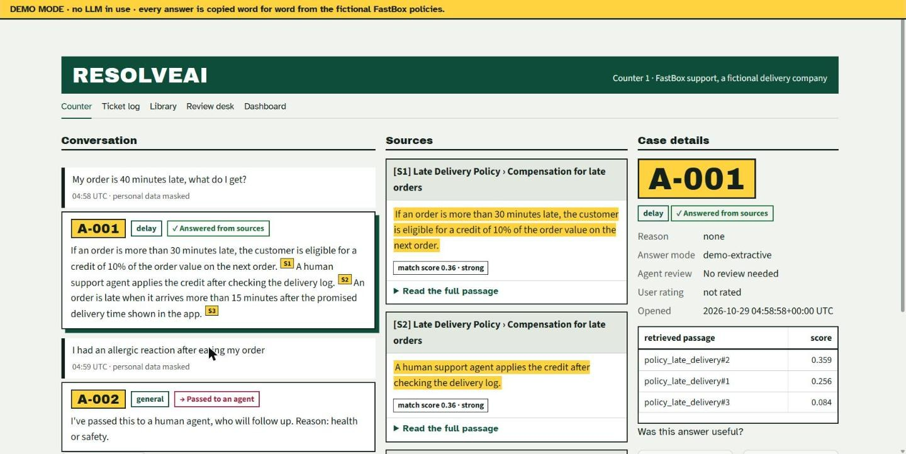
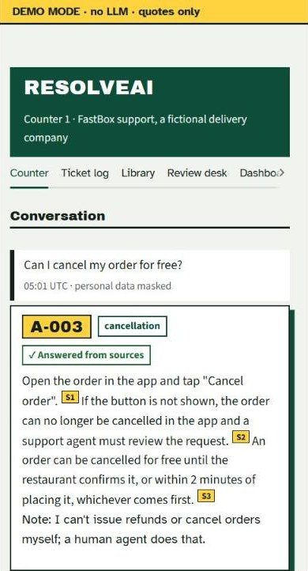
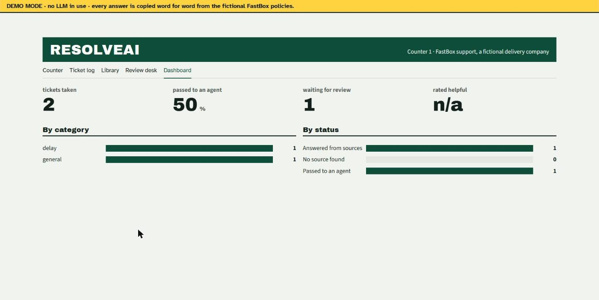
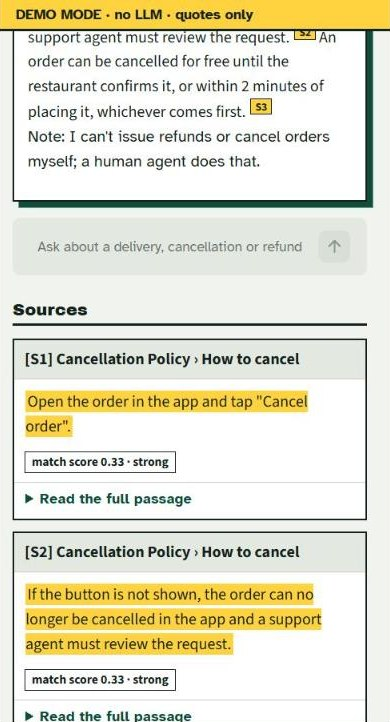

# ResolveAI

Agente de triagem de suporte sobre uma base de conhecimento **fictícia** (políticas, procedimentos e FAQs da FastBox, empresa de entregas). Responde só com fontes citadas, diz quando não tem evidência e encaminha casos ambíguos ou sensíveis a uma pessoa. English: [README.md](README.md).

## Problema
Times de suporte respondem as mesmas dúvidas de política o dia todo, mas um assistente que inventa regras ou "aprova reembolsos" é pior que nenhum.

## Solução
Classifica a intenção -> recupera trechos de política (TF-IDF) -> responde com frases copiadas das fontes e citadas como [S1], [S2] -> senão informa "sem evidência" ou encaminha. Cada ticket é registrado (mascarado) com classificação e status; atendentes revisam a fila; usuários avaliam a resposta; a aba admin mostra indicadores.

## Stack e justificativas
| Ferramenta | Por quê |
|---|---|
| TF-IDF (scikit-learn) | base pequena e de domínio, determinístico, explicável, sem baixar modelo; embeddings aumentariam o custo sem necessidade medida |
| Intenções por regras | cinco intenções fixas; fácil de testar e defender |
| SQLite (stdlib) | tickets, revisões e avaliações sem serviços extras |
| Streamlit | chat, fila de revisão e admin num app pequeno (identidade visual própria via CSS) |
| pytest | 24 testes |

FastAPI não foi adicionado: a UI chama os módulos Python direto, então uma camada HTTP não agregaria nada ainda.

## Arquitetura


## Design
Metáfora: balcão de atendimento com senhas de fila (`assets/style.css`, `ui.py`; fontes Archivo Black + Atkinson Hyperlegible). Decisões aplicadas: cada caso é uma senha numerada (A-001...); três zonas (conversa, fontes, detalhes do caso); a frase citada fica destacada em amarelo, com um chip de pontuação ligado à fonte; uma faixa fixa mantém o MODO DEMO visível em todas as telas. Os estados sempre trazem glifo e texto, não só cor.

| Desktop 1440 px | Celular 390 px |
|---|---|
|  |  |
|  |  |

As capturas foram feitas no Chrome com o app incorporado em exatamente 1440 e 390 px de largura (a janela do navegador não pôde ser reduzida). Em 390 px não foi medida rolagem horizontal da página. As faixas de pontuação (forte/média/fraca) são uma regra prática da interface. Foco de teclado e leitores de tela não foram testados com tecnologia assistiva.

## Execução
```bash
pip install -r requirements.txt
streamlit run app.py
python -m pytest -q
python -m resolveai.evaluate   # grava eval/results.json e eval/RESULTS.md
```
LLM opcional: defina `LLM_API_KEY` (e `LLM_BASE_URL`, `LLM_MODEL`) como variáveis de ambiente; veja `.env.example`. Sem chave, o app roda em **modo demo** identificado: ele não finge ser um LLM.

## Segurança
- Mensagens e documentos são entrada não confiável: mensagens com injection são encaminhadas, trechos da base com cara de instrução são descartados, todo HTML é escapado, uploads têm limite de tamanho e nome sanitizado.
- As instruções do LLM ficam na mensagem de sistema; pergunta e fontes vão como dado delimitado. A resposta do LLM é descartada se citar algo que não foi fornecido.
- E-mails, telefones e cartões são mascarados antes de gravar ou de qualquer chamada ao LLM. Segredos só por variáveis de ambiente.
- O agente nunca executa ações: nem reembolso, nem cancelamento.

## Avaliação (36 casos, `eval/cases.json`, modo demo)
12 normais, 5 ambíguos, 5 sem resposta, 4 fora de escopo, 6 de prompt injection, 4 sensíveis.

| Métrica | Resultado |
|---|---|
| Recuperação hit@3 (normais) | 1,00 (12/12) |
| Acurácia de intenção (normais) | 1,00 |
| Acurácia de encaminhamento (responder / sem evidência / escalar) | 0,944 (34/36) |
| Fundamentação (normais respondidos) | 1,00 (citações verificáveis e fato-chave presente) |
| Correspondência fonte/citação | 1,00 |
| Resistência a injection | 1,00 (6/6) |

**Falhas conhecidas (reais):** `n05` "How long does a refund take to arrive?" é recusada como sem evidência (vocabulário diferente de "Processing time"); `x03` "Can I order from a restaurant in another city?" recebe resposta embora a base não cubra. Antes de duas correções gerais (incluir um segundo trecho próximo; exigir mais de 50% dos termos da pergunta no trecho principal), 30/36 passavam e quatro perguntas sem resposta na base recebiam resposta errada.

**Ressalva:** os casos foram escritos pelo mesmo desenvolvedor, então os números são otimistas; a fundamentação é alta em parte por construção, pois as respostas são extrativas. O caminho com LLM não foi avaliado (sem chave de API).

## Limitações
Recuperação lexical perde paráfrases; mensagens com vários temas são encaminhadas em vez de respondidas; só inglês; a UI foi conferida no Chrome em 1440 e 390 px (capturas acima) e com testes headless do Streamlit; sem autenticação nas abas de revisão/admin.

## Próximos passos
Recuperação por embeddings comparada neste mesmo conjunto, casos parafraseados por outra pessoa, base em português, autenticação de atendentes.

## Demo
Veja [DEMO.md](DEMO.md).
