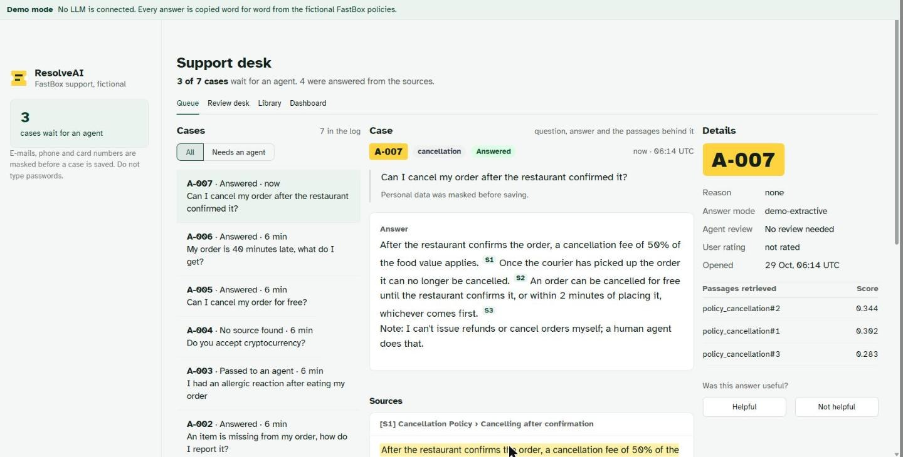
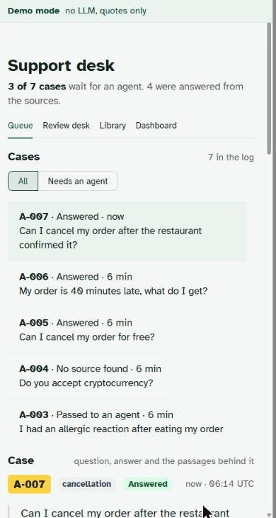
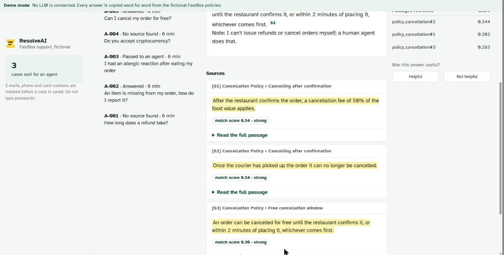
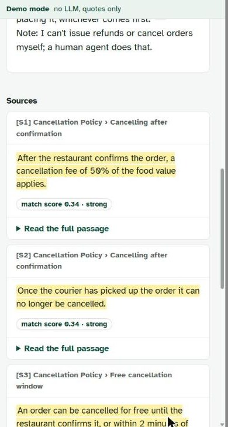

# Interface notes

The app is built around one idea: a support desk where every case is a numbered ticket (A-007 and so on), laid out like an inbox. The left column is the case list, the middle shows the open case (question, answer, then the passages behind it) and the right column has the details: intent, reason, review state, rating.

Some choices worth explaining:

- **The cited sentence is highlighted inside its passage**, with a small chip showing the TF-IDF match score. The full passage opens below, so a reviewer can check the quote in context without leaving the case.
- **Demo mode is always visible.** A thin strip at the top says whether answers come from an LLM or are quoted directly from the policies. It stays on every tab.
- **Statuses are words**, in pale pills: Answered, No source found, Passed to an agent. Colour is a second signal, never the only one.
- **Type:** Atkinson Hyperlegible for everything, and Archivo Black only for the ticket number.
- **Colours** come from `.streamlit/config.toml` (dark green as the primary) plus the yellow of the ticket stub in `assets/style.css`.

The sample queue in the screenshots was produced by running six questions through the real agent. One of them, A-001 "How long does a refund take?", shows the known retrieval miss as "No source found".

## Screenshots

| Desktop | Phone |
|---|---|
|  |  |
|  |  |

## What I checked and what I didn't

The layout was checked by eye in Chrome at 1440 px and 390 px wide. On a phone the case list scrolls inside a fixed-height box above the open case.

Match-score chips only appear for cases asked in the current browser session, because the scores aren't stored in the database.

Keyboard navigation and screen readers were not tested with assistive technology.
